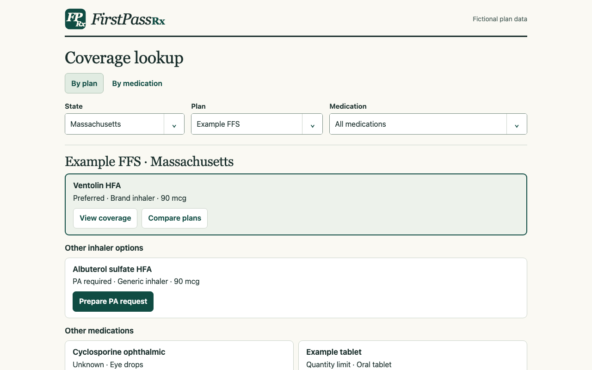
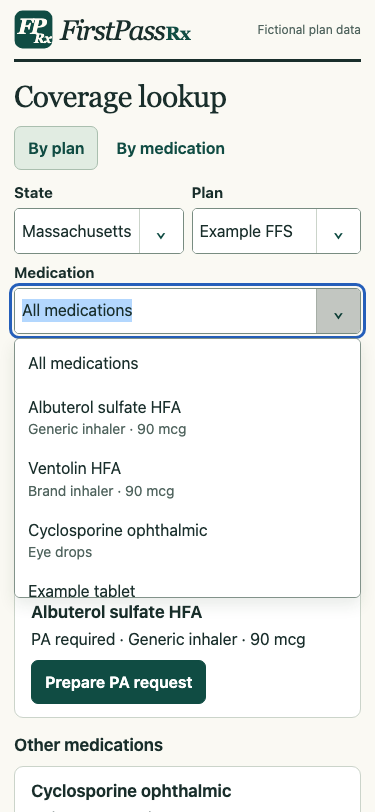
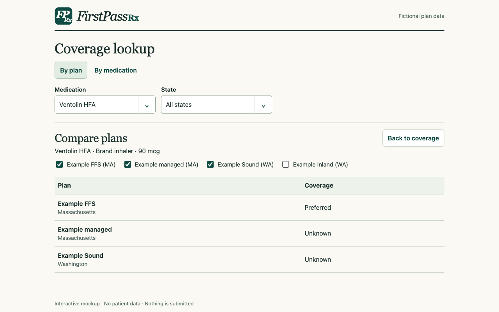
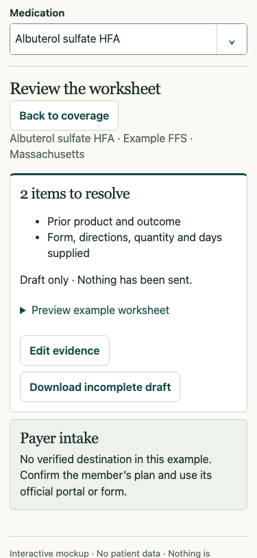

# FirstPassRx: from a drug name to the next action
Decision proposal · 11 November 2026 · for the prescriber deciding what to order and the staff member preparing the request

**Let clinicians start with a state, a plan, or a medication.** Keep all three selectors within reach when comparing coverage or preparing a request. Show the exact plan product, formulation, coverage finding, and source together. If there is a documented alternative, show it next to the requested product. If the original drug is still needed, carry it into a worksheet that identifies missing evidence and ends at the right payer form. Keep the zero-tap preferred pick for clinicians who already know their plan and class.

[Open the interactive mockup](prototype.html) · [Medication priorities and evidence](medications.md)

**Production implementation (November 11):** The app opens by plan. Medication lookup and two-plan comparison read the real guide chunks; each finding identifies its plan, verification, and sources. Exact-label matching can miss the same product when two payers describe it differently. The PA worksheet remains inline, retains same-request answers in memory and labels incomplete exports. The standalone prototype below illustrates further worksheet and handoff ideas.

## Findings before implementation

| Observed on the November 10 rolling checkout | Consequence | Design response |
|---|---|---|
| In Ohio Medicaid → Acid reflux → H2 blockers, the rendered card labels famotidine “FIRST-PASS RECOMMENDED” and “In plan: No UPDL status.” The [open review](https://github.com/pranava0x0/FirstPassRx/pull/33#discussion_r4508061425) identifies seven Medicaid reference-only records plus an Anthem P-CAB record. | The UI gives a prescribing team a positive coverage signal the source does not establish. | **Release gate:** correct or withhold those recommendations before merging #33. Regression fixture: a class-reference drug with no verified plan listing must never appear as preferred in a card **or search result**. Unknown, explicitly excluded, and confirmed no alternative are different states. |
| The active picker is state → topic → payer → class. Drug search exists in source but is parked. The saved October 27 mobile baseline is six taps for an out-of-state preferred pick. | “What does my patient’s plan say about this specific inhaler?” requires knowing the app’s taxonomy. | Add brand/generic search scoped to an explicit plan; disambiguate strength, formulation, and device in the results. Retain class browse and the remembered plan. Never convert a class match into a medication match. |
| On the default MassHealth generic albuterol example, the hero shortcut opened one builder. It had 15 input/textarea controls before entering evidence. At both tested sizes, Hide PA request → reopen erased a sample diagnosis. | Staff can lose work just by checking the coverage card. Opening the panel quickly does not mean finishing a request quickly. | Give the worksheet its own view and hold one draft in memory, keyed by plan/product/drug/indication. Back and review retain it; a context change must never reuse answers under a different policy. Offer explicit discard. |
| Copy and PDF are enabled at zero documented items. Sources, intake numbers, response timing, checklist, evidence fields, preview and actions all compete on the open panel. | An exported letter can look finished even when the reviewer still needs chart facts. Intake details appear before there is anything to send. | Put the evidence first and destination last. Allow an explicitly incomplete draft. Carry missing items into the file; a completed worksheet is still a draft until a human submits it. |
| On the rolling branch, 2,957 of 10,327 entries explicitly labeled PA in the barrier lists have structured criteria (~29%). This count excludes preferred-agent restrictions, step-only and nonformulary entries and repeats plan/class combinations. | A general checklist can easily look like plan-specific approval criteria. | If no criteria were verified, say so; offer a general worksheet and the payer source. Do not score a policy the app has not read. |

Measured with a synthetic entry in local Chrome at 375×812 and 1280×800. The [October interaction baseline](../../uat/interaction_costs.json) measures reaching the panel (one tap + one swipe on mobile), not completing it. No observed completion-time or approval-rate claim follows from that test.

## What competing tools actually offer

Public product documentation, checked November 11; this is a feature comparison, not a hands-on benchmark of signed-in products.

| Platform | What a clinician or staff member can do | Decision for FirstPassRx |
|---|---|---|
| [CoverMyMeds](https://www.covermymeds.health/articles/provider-insights/quick-guide-to-covermymeds-prior-authorization-requests) | Start a prospective request, retrieve a pharmacy-started one by key, submit electronically, receive a determination and renew prior requests. | Borrow the distinction between **start**, **continue**, and **renew**. Show which channel staff should use after preparation. A downloaded letter has no tracking number; never show “sent” or “pending” on that basis. |
| Surescripts [Real-Time Prescription Benefit](https://surescripts.com/products/real-time-prescription-benefit) and [Electronic Prior Authorization](https://surescripts.com/products/electronic-prior-authorization) | In an integrated workflow, check the member’s pricing, PA flags and covered alternatives, then exchange plan-specific questions and responses. | Compare alternatives before starting paperwork. Identify our result as a dated formulary reference; separate cash estimates from insurance costs. Member copays, live eligibility and determinations would require a partner connection. |
| [PrescriberPoint, Cequa workflow](https://prescriberpoint.com/therapies/cequa-48c3d8a/prior-authorization-forms) and [forms directory](https://prescriberpoint.com/prior-authorization-forms?page=1&sortOrder=asc) | Begin with a named drug; find forms by payer/state and related access resources. | Match the drug-first entry and direct access to plan documents. Narrow to the verified plan product and benefit channel. If the only source is a forms directory, label it “Find the form,” not “Open this drug’s form.” |

A practice with integrated ePA should use that channel to submit and track. The opportunity for FirstPassRx is the moment before submission: a usable public answer about the exact product, the source behind it, an alternative when documented, and what the reviewer still needs. The public evidence does not establish that no competitor offers this combination.

## Choose the scope

| Approach | Gain | Cost or tradeoff |
|---|---|---|
| Clean up the existing card | Smallest release; protects the fast class-first lookup. | Still requires a clinician to know the topic and class; does little for staff midway through a request. |
| **Drug-first lookup + evidence worksheet** | Solves discovery and draft completion using the data, sources, and export code already available. | Needs a compact cross-guide product index, explicit unknown states, and testing against actual policy branches. Recommended. |
| Build a full PA case inbox | Could own routing, status, renewal reminders and team follow-up. | Needs authenticated identities, patient matching, secure persistence, submission partners and returned decisions. Revisit only with a named integration partner and pilot practice. |

## Proposed interaction

**Permanent UI requirements:** No eyebrows above headings. Medication lookup uses one field for typing or selection; opening the list requires no typing.

1. **Start by plan or by medication.** By plan opens directly on one plan’s preferred inhaler, then the other inhaler options and restrictions, following the original product layout. By medication starts across plans: type or select the exact product, then optionally narrow by state or plan. Both starting points remember their selections for the current visit. A PA-required option can open its worksheet directly. For the production pilot, retain the existing class shortcut.
2. **Decide.** Lead with one finding and its source/date. Separate verified no routine PA, PA required, step, quantity/age limit, explicit exclusion and unknown. A documented plan alternative is an option to review, not an instruction to switch. If both a quantity limit and a PA apply, show both with their conditions. If coverage is excluded, show only a verified exception route. Keep price and full policy text secondary.
3. **Prepare.** Ask whether it is an initial request, renewal, or post-denial appeal only when the pathways differ. For sourced criteria, choose the indication, show shared prerequisites plus one complete applicable path, and retain the original payer language and source. Do not split conjunctions or combine alternatives from different indications. Distinguish missing evidence from an explicitly unmet criterion; allow correction. Use general documentation prompts if no approved policy is available.
4. **Review and hand off.** Show omissions, unmet criteria, and attachments still needed. Preview the letter; let staff return to the precise missing item. Offer **Export incomplete draft** or **Export for clinician review**, never “Approved.” Link to the verified form or portal for that benefit; if only a phone/fax or directory is verified, label it accurately. A denial takes the user to a separate appeal path. Do not imply submission, eligibility, an insurance price or a payer decision.

**Compare plans** is a separate action on a medication. Choose the plans to include for that exact formulation. The comparison reports each plan’s status, including unknown; Back returns to the original options. Keep routine policy context in plain text alongside the answer, and use the same rounded button treatment for secondary actions. The prototype does not invent prices or payer sources for its fictional plans.

**Try it:** start **By plan** → **Compare plans** on Ventolin → change the included plans → **Back to coverage**. Or start **By medication** → type “Ventolin” → select the product → choose a plan. For a PA, open **Prepare PA request** directly on generic albuterol in Example FFS. The worksheet stays with that exact plan and product when switching flows. Both entry points share the FPRx monogram, rounded controls and the no-eyebrows rule. It uses fictional policy, preset sample evidence, no identifiers, no network calls, and a real local text download. It does not implement live clinical policies, branching indications, a verified payer route, renewal, or appeal; those are implementation requirements, not demonstrated capabilities.

## Build order and how to judge it

| Sequence | Deliverable and owner | Acceptance gate |
|---|---|---|
| 0 · before #33 merges | Data maintainer: resolve reference-only rows and test card/search parity. | Replay the Ohio case plus a verified preferred control and an explicit exclusion. Zero unknowns presented as covered; verify the remaining records named in the review. |
| 1 · first pilot | Product/frontend: one plan, one inhaler class. Index actual drugs, brand aliases and devices; reuse the existing guide loader for detail. Preserve shared URLs and class shortcuts. | In five moderated synthetic tasks with prescribers/staff, at least 4/5 find the exact product and correct next step without help; zero wrong-plan positives. Keep the existing zero-tap default and PA-open mobile budgets. |
| 2 · after the pilot | Frontend and clinical reviewer: dedicated worksheet; same-context in-memory draft, explicit missing evidence, sourced intake. Reuse existing ICD-10, letter, and PDF logic. | Test initial, renewal, missing policy, not met, ALL/ANY, incomplete export, and unavailable form. Hide/back loses zero answers; changing plan never carries evidence over. No entered data in URLs, local storage, telemetry or outbound requests. |
| 3 · expand on evidence | Data maintainer: WA ocular pilot and PA-depth queue in [medications.md](medications.md); add one complex indication policy only after review. | Per product: dated formulary evidence; separately sourced criteria/intake or explicit gaps. Repeat tasks against a multi-path policy. Track time to **reviewed draft**, wrong-route count and omitted required fields in consented usability sessions; do not use letter downloads as a proxy for approval. |

**Pilot decision:** compare old vs new on identical synthetic tasks: known plan/class, known drug/unknown class, quantity limit, missing entry, and unfinished request. Measure time and wrong actions, not just taps. Expand only if median time to a correct reviewed draft improves while the class-first baseline and exact-product accuracy hold. Stop and revise on any case where unverified coverage appears preferred or an incomplete draft appears submitted.
